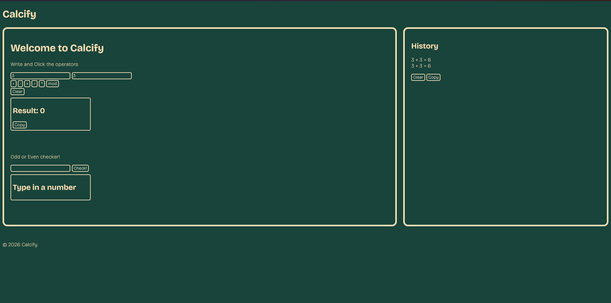

# Calcify

A JavaScript calculator with the simple operations and a copy and history function.

## Features

- Basic arithmetic operations
- Power and remainder operations
- Odd/even checker
- Calculation history
- Persistent history using localStorage
- Copy result and history to clipboard
- Decimal support
- Responsive layout

## Technologies

- HTML
- CSS
- JavaScript

## How to use

Type in the input spaces the two values and click one of the operation symbols, then voilà, your result.

There's also the Odd or Even checker, put in the number you want and then click "Check!", your result will be under the text field.

## Screenshots

## What I learned

Learnt in practice JS (which I hadn't used before!), used APIs for clipboard, learned about alerts, functions, syntax, value treatment.. a lot of stuff.. haha..

Also practiced a bit of CSS responsiveness (which I hadn't used much before.).

I already had a lot of previous experience with HTML, so nothing that new.

## Running locally

To run, you can download the project files and open the index.html, or you can use the website ([Click here!](https://wirum.github.io/Calcify/)).

## License

MIT License.